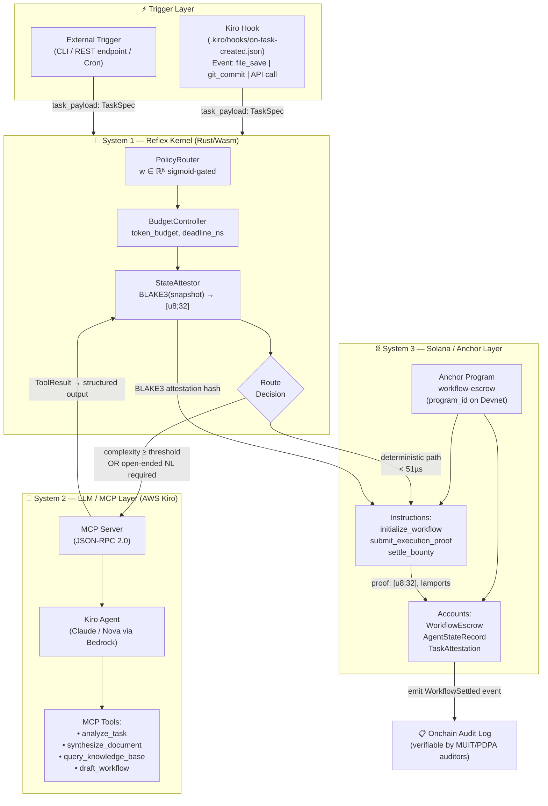

# ReflexWork — System Topology

## Mermaid Diagram



---

## ASCII Topology (Printable / Terminal)

```
┌─────────────────────────────────────────────────────────────────────┐
│                        REFLEXWORK TOPOLOGY                          │
│                    "Relentless Simplification"                      │
└─────────────────────────────────────────────────────────────────────┘

  TRIGGERS
  ┌──────────────────┐     ┌──────────────────────┐
  │  Kiro Hook       │     │  External (CLI/REST)  │
  │ .kiro/hooks/*.json│     │  CronJob / Webhook   │
  └────────┬─────────┘     └──────────┬────────────┘
           │   TaskSpec payload        │
           └──────────────┬────────────┘
                          ▼
  ┌─────────────────────────────────────────────────────┐
  │         SYSTEM 1 — REFLEX KERNEL (Rust/Wasm)        │
  │  ┌─────────────────────────────────────────────┐   │
  │  │  PolicyRouter                               │   │
  │  │    w ∈ ℝᴺ,  gate(x) = σ(wᵀx + b)           │   │
  │  │    route = argmax_k P(k|x; w)               │   │
  │  └───────────────┬─────────────────────────────┘   │
  │                  │                                  │
  │  ┌───────────────▼─────────────────────────────┐   │
  │  │  BudgetController                           │   │
  │  │    token_budget, deadline_ns, cost_ledger   │   │
  │  └───────────────┬─────────────────────────────┘   │
  │                  │                                  │
  │  ┌───────────────▼─────────────────────────────┐   │
  │  │  StateAttestor                              │   │
  │  │    hash = BLAKE3(snapshot_bytes)            │   │
  │  │    PersonalitySnapshot → [u8; 32]           │   │
  │  └───────────────┬─────────────────────────────┘   │
  │                  │                                  │
  │              ROUTE DECISION                        │
  │          ┌───────┴───────┐                         │
  │    NL/Complex?     Deterministic?                   │
  │          │               │                         │
  └──────────┼───────────────┼─────────────────────────┘
             │               │
             ▼               ▼ (< 51µs)
  ┌──────────────────┐   ┌───────────────────────────────┐
  │   SYSTEM 2       │   │   SYSTEM 3 — SOLANA / ANCHOR  │
  │   MCP Server     │   │                               │
  │   (JSON-RPC 2.0) │   │  ┌─────────────────────────┐ │
  │                  │   │  │  initialize_workflow()   │ │
  │   Kiro Agent     │   │  │  submit_execution_proof()│ │
  │   (via Bedrock)  │   │  │  settle_bounty()         │ │
  │                  │   │  └─────────────────────────┘ │
  │   MCP Tools:     │   │                               │
  │  • analyze_task  │   │  WorkflowEscrow Account       │
  │  • synthesize    │   │  AgentStateRecord Account     │
  │  • query_kb      │   │  TaskAttestation Account      │
  │  • draft_wf      │   └───────────────────────────────┘
  └────────┬─────────┘               │
           │                         │
           │  ToolResult +           │  BLAKE3 proof
           │  BLAKE3 attestation     │  Lamport settlement
           └──────────►──────────────┘
                          │
                          ▼
              ┌─────────────────────┐
              │  Onchain Audit Log  │
              │  (Devnet / Mainnet) │
              │  PDPA-Compliant ✓   │
              └─────────────────────┘

  Latency Budget
  ─────────────────────────────────────────────
  System 1 (deterministic fast path) :  14–51 µs
  System 2 (MCP invocation, async)   : ~350–800 ms (acceptable)
  System 3 (Solana TX, 200ms era)    : ~200–400 ms
  Total worst-case (S1+S2+S3)        : < 1.25 s
  Total fast-path (S1+S3 only)       : < 1 ms
```

---

## Data Flow Summary

| Step | Actor | Action | Output |
|------|-------|--------|--------|
| 1 | Kiro Hook | Detects workflow trigger event | `TaskSpec` JSON payload |
| 2 | PolicyRouter | Sigmoid-gates task vector `x` against `w ∈ ℝᴺ` | Route decision enum |
| 3a | BudgetController | Checks token_budget, deadline_ns | Pass / Reject |
| 3b | StateAttestor | BLAKE3-hashes current snapshot | `[u8; 32]` commitment |
| 4a (NL path) | MCP Server | Dispatches to Kiro Agent via JSON-RPC | `ToolResult` struct |
| 4b (fast path) | Anchor Program | Directly calls `submit_execution_proof` | Onchain TX |
| 5 | `settle_bounty` | Verifies BLAKE3 proof, releases escrow | Lamport transfer + event |
| 6 | Audit Log | Permanent onchain record | PDPA-compliant trail |
